# 生活圈体检助手 · 15 分钟生活圈智能体检与规划

> 基于百度地图开放能力，以**真实步行路网**测算 15 分钟生活圈，自动统计九类民生设施覆盖，识别「1 公里内没有菜市场、药店或小学」的**服务盲区**，并给出**经 API 实测验证的补点选址方案**。

[](https://github.com/aeryking/15min-life-circle/actions/workflows/ci.yml)
[](LICENSE)


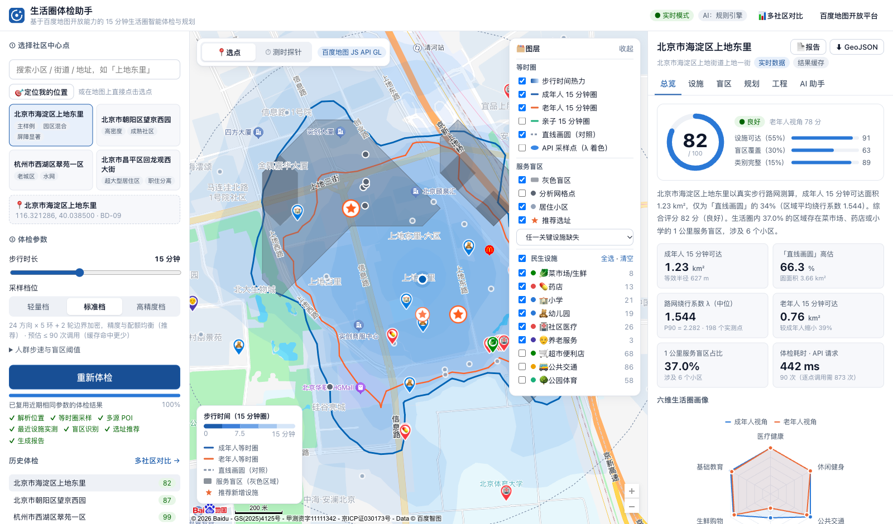

## 目录

- [核心亮点](#核心亮点)
- [快速开始（三种方式，零配置可运行）](#快速开始)
- [环境变量与 API Key 配置](#环境变量与-api-key-配置)
- [功能一览](#功能一览)
- [技术架构](#技术架构)
- [算法与工程设计](#算法与工程设计)
- [真实对比测试](#真实对比测试)
- [接口说明](#接口说明)
- [项目结构](#项目结构)
- [测试与 CI](#测试与-ci)
- [常见问题](#常见问题)

## 核心亮点

| | 做法 | 效果（4 个真实社区实测） |
|---|---|---|
| 🧭 **真实路网等时圈** | 扇形多环采样 → 自适应边界加密 → LOOCV 自选参各向异性 IDW ⊕ 极坐标双线性集成 → marching squares 等值面 | 圈内/圈外判定准确率 **91.7%–97.5%**（直线画圆只有 60%–72.5%）；直线画圆高估面积 **48%–66%** |
| ⚡ **批量距离矩阵** | 所有「两点距离」统一走批量步行算路；分块规划 + 配对调度器 + 并发流水线 | 每次体检 **88–106 次请求**，逐点调用需要 873–1176 次，**节省约 90%**；缓存命中时 0.5 秒出结果 |
| 🩶 **服务盲区** | 以**小区点位**为主结论；上下界剪枝 + **分支定界**严格实测（不依赖「最近几个」假设）+ **复核检索**补回被分页截断的设施；同时对照直线 1 公里口径，找出**隐性盲区** | 独立真值核验 **160 / 160**（直线 1 公里口径仅 115 / 160）；上地东里 6 个盲区小区**全部是直线看不出的隐性盲区** |
| ★ **补点规划** | 最大覆盖选址（MCLP）+ **候选点 API 实测择优** | 如实报告「实测可消除 X% 盲区需求」，不虚报 |
| 🛡 **容错降级** | 自适应令牌桶（AIMD）、指数退避重试、按服务熔断、多级降级、**故障演练开关** | 注入 20% 网络失败 + 10% 限流：42 次故障全部被重试消化，**结果与无故障时完全一致** |
| 📦 **零配置演示** | 真实 API 响应**录制 / 回放**；无浏览器端 AK 时自动切换开源底图 | 评审**无需任何 Key**：`docker compose up` 即可体验全部功能 |
| 👴 **适老化 + AI** | 一次采样同时生成成年人 / 老年人 / 亲子三类等时圈；规则引擎诊断 + 可选大模型问答 | 成年人 / 老年人 / 亲子三视角评分（各自步速 + 各自维度权重）、雷达三线对比；问答结果联动地图定位 |

## 快速开始

需要 **Node.js ≥ 20.12**（或 Docker）。不配置任何 AK 时，系统自动进入**离线回放模式**：用仓库内录制的真实百度 API 响应完整运行全部算法，可体验 4 个预置样例社区。

### 方式一：一键脚本

```bash
git clone https://github.com/aeryking/15min-life-circle.git && cd 15min-life-circle
./start.sh          # Windows：start.bat
# 浏览器打开 http://localhost:8787
```

### 方式二：npm

```bash
npm ci
npm run build       # 构建前端
npm start           # 启动服务 http://localhost:8787
```

开发模式（后端热重启 + Vite 前端热更新，访问 http://localhost:5173）：`npm run dev`

### 方式三：Docker

```bash
docker compose up -d --build     # http://localhost:8787
# 需要实时数据时：cp .env.example .env，填写 AK 后重启
```

镜像约 170 MB，多阶段构建，以非 root 用户运行，并内置健康检查。

## 环境变量与 API Key 配置

复制模板后按需填写：`cp .env.example .env`。**`.env` 已被 `.gitignore` 忽略，仓库中不含任何真实密钥。**

| 变量 | 说明 | 默认 |
|---|---|---|
| `BAIDU_SERVER_AK` | 百度**服务端** AK，只在后端使用，**不会下发到浏览器**。需开通：地点检索、地理编码、逆地理编码、批量算路、路线规划、坐标转换 | 空（回放模式） |
| `BAIDU_BROWSER_AK` | 百度**浏览器端** AK，用于 JS API GL 底图；需设置 Referer 白名单（本地可填 `localhost*`） | 空（开源底图） |
| `DATA_MODE` | `auto`：有服务端 AK 用实时模式，否则回放；`live`；`replay` | `auto` |
| `BAIDU_QPS` / `BAIDU_CONCURRENCY` | 令牌桶 QPS 上限 / 在途并发上限 | 8 / 6 |
| `BAIDU_TIMEOUT_MS` / `BAIDU_MAX_RETRIES` | 单次超时 / 最大重试次数 | 8000 / 3 |
| `OSM_ENABLED` | 是否启用 OpenStreetMap 补充数据源 | `true` |
| `LLM_BASE_URL` / `LLM_API_KEY` / `LLM_MODEL` | 可选，兼容 OpenAI 协议的大模型（通义千问、DeepSeek、文心、Kimi 等），用于报告润色与智能问答；DeepSeek 示例：`https://api.deepseek.com` + `deepseek-flash`。`LLM_BASE_URL` 填厂商文档中的 Base URL（与 OpenAI SDK 的 `base_url` 相同），程序自动拼接 `/chat/completions` | 空（规则引擎） |
| `LLM_THINKING` | 可选，是否支持对话框的「深度思考」开关（开启后展示思考链）；`auto` 时按地址识别 DeepSeek | `auto` |
| `LLM_EXTRA_BODY` | 可选，附加到大模型请求体的 JSON 参数；DeepSeek 未配置时默认关闭思考模式 | 空 |
| `ANALYSES_DIR` / `VISITORS_DIR` | 体检记录 / 访客数据（各自的历史与对话）存放目录 | `data/analyses` / `data/visitors` |
| `CHAOS_ENABLED` 等 | 故障注入，也可以在界面「技术指标」页实时开关 | `false` |

**AK 申请**：登录 [百度地图开放平台](https://lbsyun.baidu.com) → 控制台 → 应用管理 → 创建应用，分别创建「服务端」和「浏览器端」两个应用。完成开发者认证后可获得更高的配额。

**密钥安全**：
- 服务端日志只打印脱敏后的 AK（`CGCu****hUQe`）；
- 缓存键和回放数据都会剔除 `ak` 参数；
- `/api/config` 只返回浏览器端 AK（浏览器端 AK 本来就要暴露给前端，依靠 Referer 白名单保护），有单元测试保证服务端 AK 不会泄露。

**访客隔离**（公网部署无需登录）：
- 服务端为每个浏览器签发随机访客 ID（144 位，`HttpOnly; SameSite=Lax` Cookie，HTTPS 下自动加 `Secure`），前端脚本读不到；
- 体检历史、多社区对比的可选范围、AI 对话都按访客隔离，其他人看不到你查过哪些社区、问过什么；
- 对话按「访客 × 体检编号」分别保存，刷新或切换报告后自动恢复；磁盘上只保存访客 ID 的 SHA-256 摘要；
- 体检编号含 72 位随机数，无法枚举；相同参数的体检结果（公开地图数据的计算结果）仍在访客间复用，以节省 API 配额；
- 升级前的历史记录由升级后第一位访客自动认领（本地单人使用时就是你自己）。

## 功能一览

| 模块 | 功能 |
|---|---|
| 选点 | 地址搜索联想（输入提示 API）、地图点选（逆地理编码）、浏览器定位（WGS-84 → BD-09，坐标转换 API；电脑主要靠附近 Wi-Fi 推算位置，成功时显示精度，失败时按原因给出中英双语提示，定位点以坐标命名）、4 个预置样例社区；左侧面板可收起为一条竖向把手，给地图让出空间 |
| 参数 | 步行时长 5–30 分钟、三档采样精度（体检前显示预估调用次数）、三类人群步速、盲区阈值 |
| 等时圈 | 步行时间热力（2.5 分钟一档）、成年人 / 老年人 / 亲子等时圈、直线画圆对照、API 采样点（按绕行系数着色）、**测时探针**（点击任意位置即得步行时间；一键「实测验证」调用 1 次批量算路，现场对比插值估算与百度实测，并累计平均误差） |
| 设施 | 九类民生设施的地图分层、圈内数量、目标时间覆盖率、最近设施实测步行距离、多源清洗流水线与剔除原因 |
| 盲区 | **小区盲区清单**（每类设施的实际步行距离、超出多少、隐性盲区标记）、灰色盲区与隐性盲区图层（可按类别切换）、真实步行 vs 直线口径对比、优先改造片区、判定方式构成与复核检索记录 |
| 规划 | 补点选址（实测择优）、改造建议（分优先级）、适老化评估（成年人 vs 老年人）、亲子友好评估（幼儿园 / 小学 / 公园 / 医疗的亲子步行时间对照目标） |
| 工程 | 请求数 vs 逐点基线、批量因子、分阶段耗时、按服务统计、LOOCV 精度、降级事件、限流器与熔断器实时状态、**故障演练** |
| AI 助手 | 自然语言问答（「老人看病方便吗」「哪些小区是盲区」），回答内容联动地图标注（标注点以落下弹跳 + 地面波纹的脉冲动画突出显示，系统开启「减少动态效果」时自动停用动画） |
| 报告 | 体检报告（内置矢量示意图）：**「⬇ 下载 PDF」**直接生成 A4 分页的 PDF 文件（标题、表格行、列表项、示意图不会被切开，页脚带页码），**「🖨 打印」**走浏览器打印预览（只保护小单元不跨页，表头跨页重复，暗黑模式下也按白纸打印）；GeoJSON 导出（可直接导入 QGIS） |
| 历史 | **体检历史页**（`/history`，仅本人可见）：搜索社区 / 地址，按统计口径筛选，按时间 / 评分 / 盲区小区数排序；显示综合、老年人、亲子三视角评分；勾选多个直接进入对比，可从自己的历史中移除 |
| 对比 | **多社区对比看板**：最多 10 个社区 × 34 项指标（7 组）；冠军 / 最需关注卡片与自动洞察、可切换指标的排名赛道、自选 X/Y 轴的象限气泡图、体检热力矩阵、最近设施步行分布、六维画像墙、可排序明细表；点击任一图表中的社区，所有图表联动高亮；按**统计口径**（步行时长 + 盲区阈值 + 人群步速）分组筛选，口径不一致时给出警告；采样档位（低 / 中 / 高）只影响精度、可以比较，同名社区自动加「（30′·高精度）」等后缀区分 |
| 主题 | 浅色 / 暗黑模式一键切换（默认跟随系统，记住选择）；百度底图使用个性化暗色样式，开源底图做瓦片暗化；两套配色分别经可视化配色校验，报告纸张始终保持浅色，所见即所打印 |

<table>
<tr><td>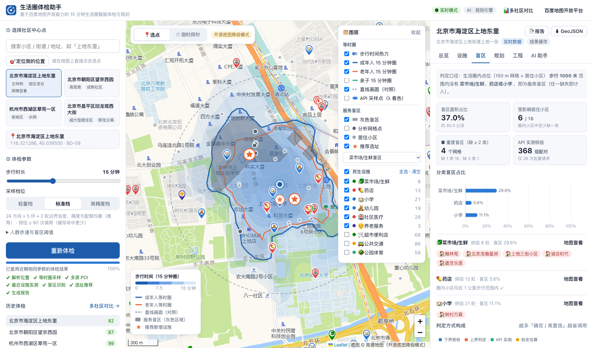<br/><b>服务盲区</b>：灰色区域、受影响小区、判定方式构成</td><td>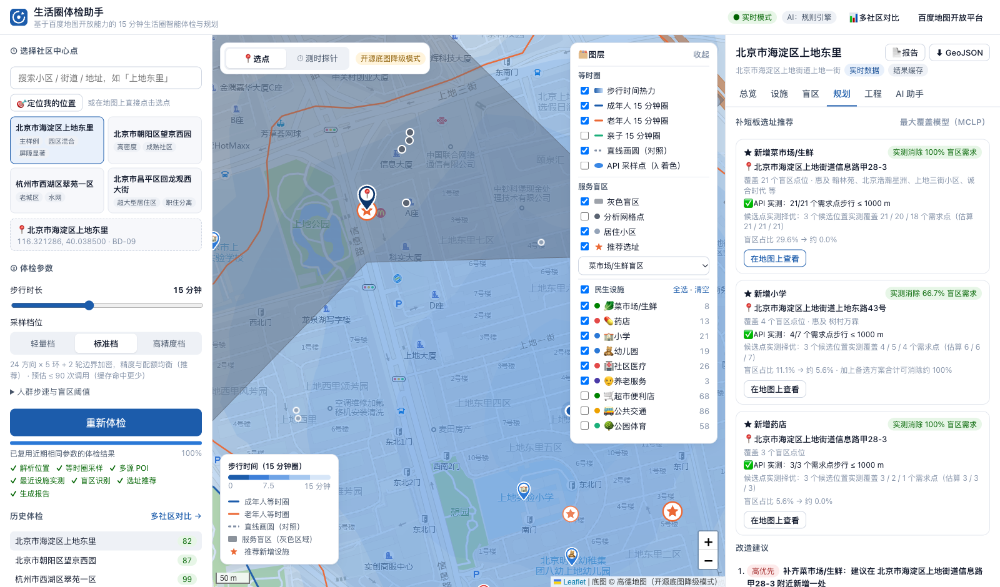<br/><b>补点规划</b>：候选点实测择优、改造建议</td></tr>
<tr><td>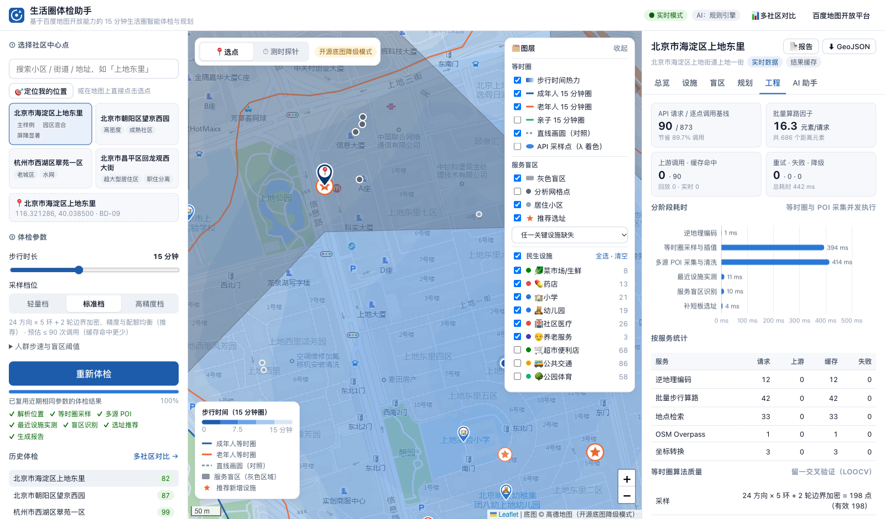<br/><b>工程指标</b>：批量化收益、LOOCV、降级与故障演练</td><td>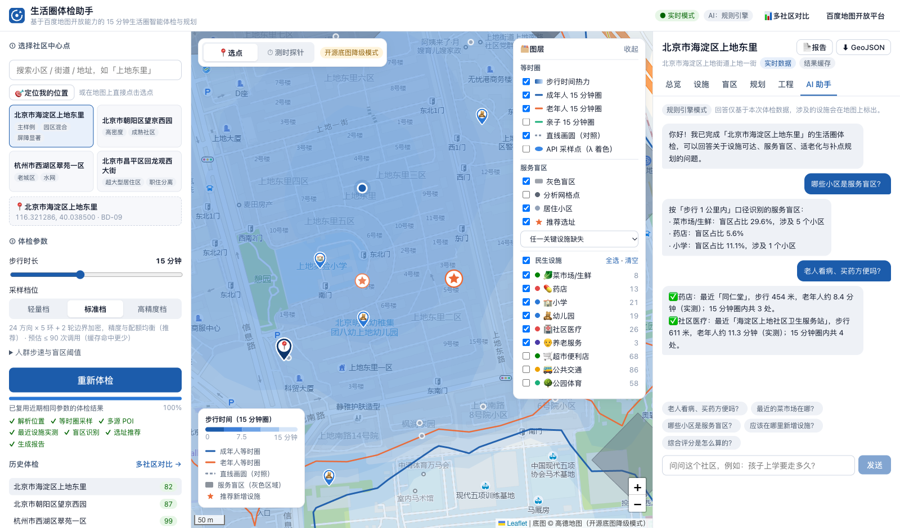<br/><b>AI 助手</b>：回答联动地图定位</td></tr>
<tr><td>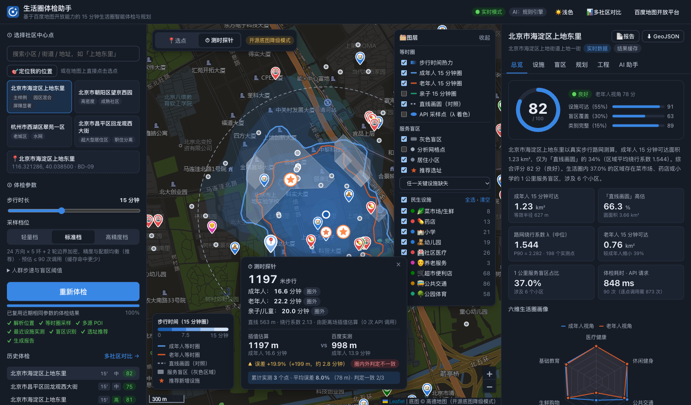<br/><b>测时探针 + 实测验证</b>：估算 vs 百度实测，当场证明插值精度</td><td>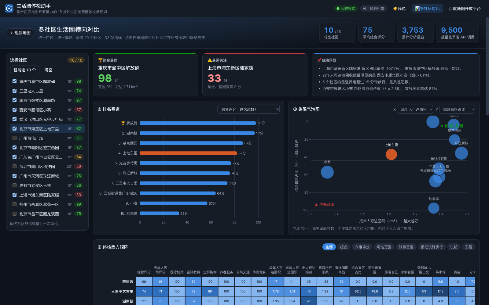<br/><b>多社区对比看板</b>：10 个社区 × 34 项指标，图表联动</td></tr>
<tr><td>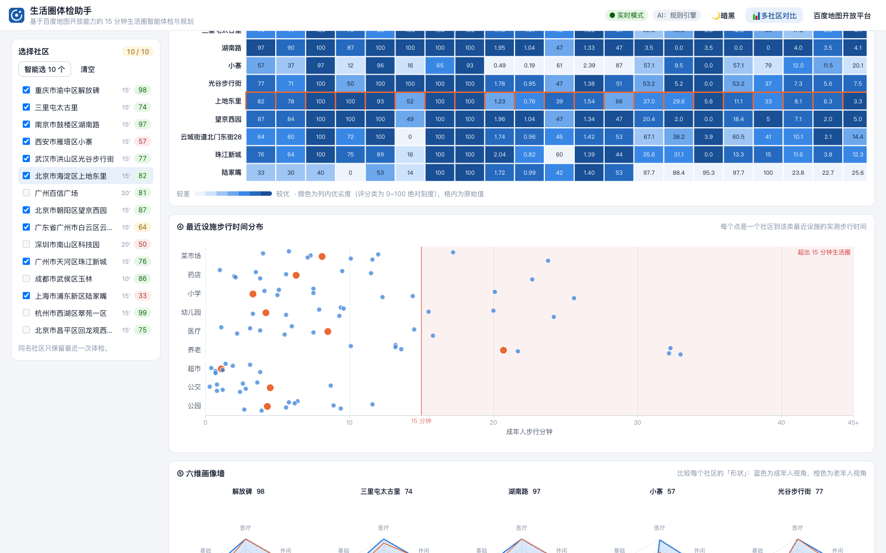<br/><b>体检热力矩阵与步行时间分布</b></td><td></td></tr>
<tr><td>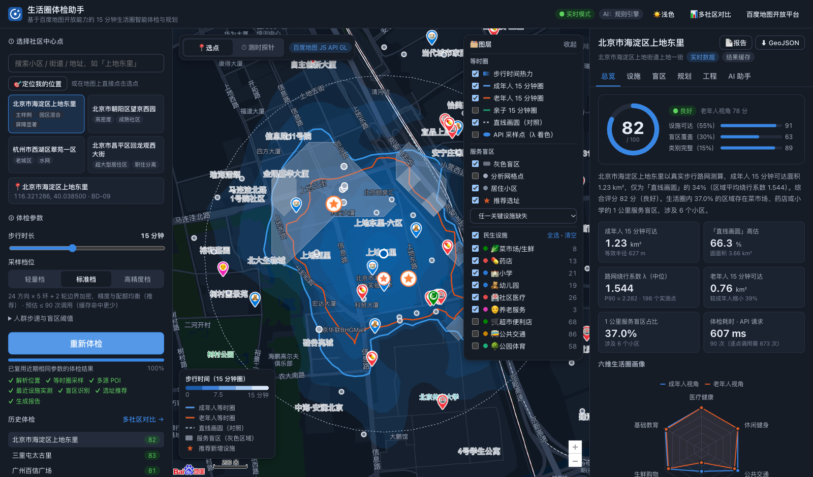<br/><b>暗黑模式</b>：底图、覆盖物、图表同步切换，配色经校验</td><td><br/><b>浅色模式</b></td></tr>
<tr><td>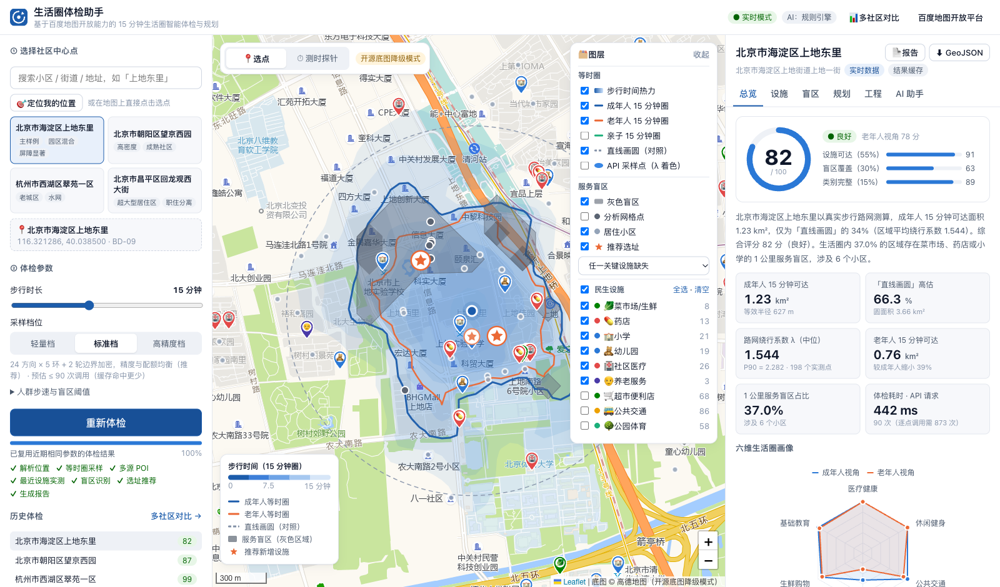<br/><b>开源底图降级模式</b>：未配置浏览器端 AK 时自动启用</td><td>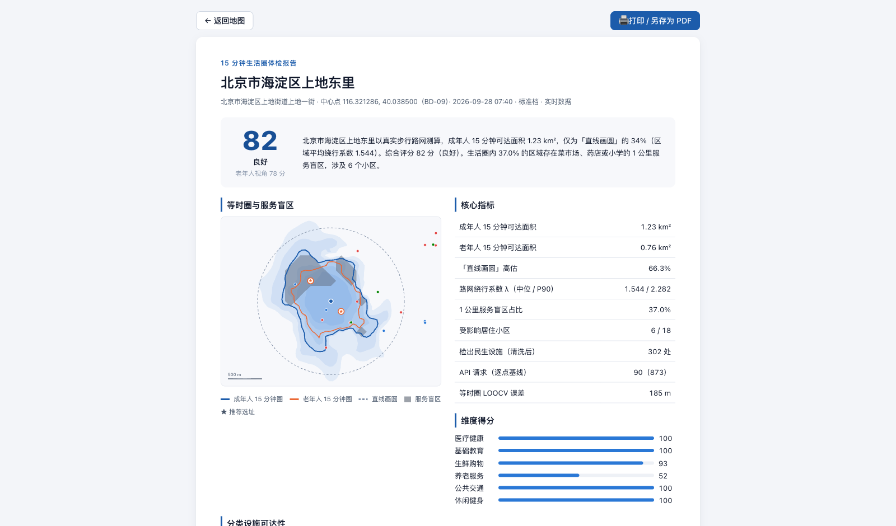<br/><b>体检报告</b>：一键下载 PDF 或打印</td></tr>
</table>

## 技术架构

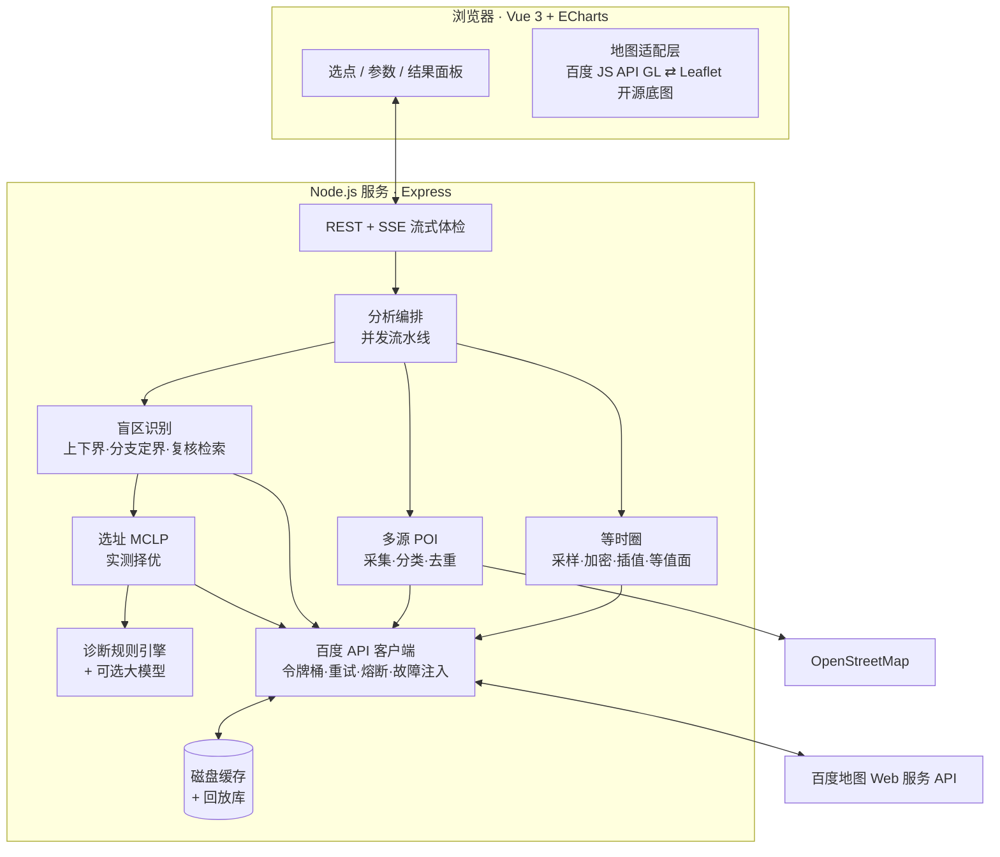

- **后端**：Node.js（原生 ESM）+ Express，只依赖 `express` 和 `d3-contour` 两个运行时库，算法全部自研；
- **前端**：Vue 3 + Vite + ECharts（按需引入）；地图层抽象为统一的适配器接口，百度 GL 与 Leaflet 可以无缝切换；
- **数据流**：SSE 边算边推，等时圈先出图，POI、盲区、选址依次叠加。

## 算法与工程设计

完整设计文档：

| 文档 | 内容 |
|---|---|
| [**评审对照表**](docs/评审对照表.md) | 评分细则逐项对应的实现、界面入口与验证证据 |
| [地图 API 调用策略](docs/地图API调用策略.md) | 接口选型、批量矩阵与配对调度、并发流水线、AIMD 限流、重试与熔断、降级链路、录制回放、配额预估、故障演练 |
| [等时圈生成算法](docs/等时圈生成算法.md) | 扇形多环采样、割线法边界加密、λ / 绕行增量插值、各向异性 IDW + LOOCV 选参、极坐标双线性与模型集成、等值面与伪岛剔除 |
| [多源 POI 数据清洗策略](docs/多源POI数据清洗策略.md) | 三路数据源、九类分类体系、标签优先的统一分类、软规则、四级去重、清洗效果 |
| [服务盲区识别算法](docs/服务盲区识别算法.md) | 判定口径（小区点位、真实步行 vs 直线、隐性盲区）、上下界剪枝、分支定界、复核检索、在线自校准、灰色盲区与斑块、MCLP 选址与实测择优、独立真值核验 |
| [真实对比测试报告](docs/真实对比测试报告.md) | 4 社区 × 120 随机检验点的等时圈精度对比，以及盲区判定的独立真值核验（与直线口径对比） |
| [使用场景](docs/使用场景.md) | 街道体检、补短板选址、适老化、多社区对比等六个场景 |

## 真实对比测试

`npm run validate` 以百度批量算路对**独立随机检验点**的实测距离为真值（每个社区 120 个点，与算法采样点互不重合），对比四种方法：

| 社区 | 本系统 MAE / 判定准确率 | 常数绕行系数 | 直线画圆 | 盲区核验（本系统 / 直线 1 km） |
|---|---:|---:|---:|---:|
| 北京 上地东里（园区与铁路屏障） | **126 m / 97.5%** | 265 m / 91.7% | 534 m / 60.0% | 40/40 / 24/40 |
| 北京 望京西园（高密度成熟社区） | **59 m / 97.5%** | 116 m / 89.2% | 366 m / 72.5% | 40/40 / 25/40 |
| 杭州 翠苑一区（水网老城区） | **78 m / 91.7%** | 131 m / 85.0% | 421 m / 63.3% | 40/40 / 40/40 |
| 北京 回龙观西大街（超大街区） | **79 m / 91.7%** | 172 m / 86.7% | 437 m / 70.8% | 40/40 / 26/40 |

盲区核验的真值与系统判定规则无关：以抽检点为中心重新检索设施，并从抽检点出发实测到全部候选。报告中同时列出「单射线插值」基线，并附有实地步行抽检模板，详见 [真实对比测试报告](docs/真实对比测试报告.md)。

## 页面地址

每个页面状态都有独立地址：刷新不丢失，可以收藏、分享，浏览器前进 / 后退可用。

| 地址 | 页面 |
|---|---|
| `/` | 首页：选点、体检 |
| `/r/:id` | 某份体检报告；`?tab=facilities\|blind\|plan\|assistant\|engineering` 直接打开指定标签页 |
| `/r/:id/print` | 体检报告页：下载 PDF / 打印 |
| `/compare?ids=a,b,c` | 多社区对比（≤ 10 个） |
| `/history?q=关键词` | 体检历史：搜索、按口径筛选、排序，勾选多个直接对比，可从自己的历史中移除 |

分享规则：报告链接「知道链接即可查看」（编号含 72 位随机数，无法枚举），打开后会加入自己的历史；AI 对话始终只有本人可见。`?basemap=osm`、`?debug=1` 在页面间切换时保留。

## 接口说明

| 方法 | 路径 | 说明 |
|---|---|---|
| GET | `/api/config` | 前端配置：数据模式、分类、档位（含预估调用）、预置社区 |
| GET | `/api/analyze/stream?lng&lat&name&minutes&tier&adultSpeed&elderlySpeed&childSpeed&threshold&fresh` | **SSE 流式体检**，事件：`progress` / `stage` / `done` / `fail` |
| GET | `/api/history?limit=` | 当前访客的体检历史（新 → 旧，默认 30 条、最多 100 条），含三视角评分与盲区小区数；`/api/analyses` 为兼容旧版的同义接口 |
| DELETE | `/api/history/:id` | 从当前访客的历史中移除（连同其在该报告下的对话），成功返回 204；报告本身保留，其他访客不受影响 |
| GET | `/api/analyses/:id` | 体检详情（通过链接打开的报告会加入当前访客的历史） |
| POST | `/api/analyses/:id/probe` | 测时探针实测验证 `{ lng, lat }`：1 次批量算路返回中心点到该点的真实步行距离 |
| POST | `/api/analyses/:id/ask` | 多轮智能问答 `{ question }`，自动带上当前访客在该报告下的历史对话 |
| POST | `/api/analyses/:id/ask/stream` | **流式**多轮问答（SSE over POST），请求 `{ question, thinking }`，事件：`meta`（回答方式与地图高亮）/ `reasoning`（思考链增量，开启深度思考时）/ `delta`（增量文字）/ `done` / `fail`；客户端断开时中止上游大模型请求 |
| GET · DELETE | `/api/analyses/:id/chat` | 读取 / 清空当前访客在该报告下的对话 |
| POST | `/api/analyses/:id/polish` | 大模型润色报告（需配置 LLM） |
| GET | `/api/analyses/:id/geojson` | GeoJSON 导出 |
| GET | `/api/compare?ids=a,b,…` | 多社区对比（≤ 10 个，自动去重），返回 34 项指标的元数据（分组、单位、优劣方向）与各社区取值 |
| GET | `/api/suggest?q=` · `/api/reverse?lng&lat` · `/api/geocode?address&city` | 输入提示 / 逆地理编码 / 地理编码 |
| POST | `/api/geoconv` | 坐标转换 `{ points, from: 'wgs84'|'gcj02' }` |
| GET | `/api/status` · PUT `/api/chaos` | 限流器 / 熔断器 / 调用台账；故障注入开关 |
| GET | `/api/health` | 健康检查 |

## 项目结构

```
├── server/
│   ├── baidu/          # 百度 API：客户端（重试/熔断）、自适应限流、缓存与回放、故障注入、服务封装
│   ├── core/           # 业务算法：等时圈、插值、等值面、POI 清洗、盲区、选址、评分、诊断、问答
│   ├── geo/            # 地理计算与坐标系转换
│   ├── routes/         # REST + SSE 接口
│   └── store/          # 体检结果存储与结果级缓存
├── web/src/
│   ├── map/            # 地图适配层（百度 GL / Leaflet）、图层构建、图标
│   ├── components/     # 控制面板、地图、结果面板与 6 个标签页、报告、对比
│   └── utils/          # 配色（经校验）、格式化、前端地理工具
├── scripts/            # record（录制回放）、validate（真实对比测试）、dev
├── tests/              # 单元测试 + 离线回放端到端测试（node:test）
├── data/
│   ├── presets.json    # 预置样例社区
│   ├── replay/         # 真实 API 响应回放库（已脱敏）
│   └── validation/     # 真实对比测试原始数据
├── docs/               # 技术设计文档与测试报告
├── Dockerfile · docker-compose.yml · start.sh · start.bat
└── .github/workflows/ci.yml
```

## 测试与 CI

```bash
npm test          # 54 项：地理计算、限流/熔断/重试、插值与等值面、合成城市端到端、POI 清洗、盲区与选址（分支定界 / 复核检索 / 隐性盲区）、离线回放全流程、故障演练、HTTP/SSE 接口、访客隔离、分享链接、前端路由、多轮与流式问答
npm run lint      # ESLint + Prettier 检查
npm run validate  # 真实对比测试（需服务端 AK），生成 docs/真实对比测试报告.md
npm run record    # 重新录制回放数据（需服务端 AK）
```

GitHub Actions（`.github/workflows/ci.yml`）会在 Node 20 与 22 上依次执行 Prettier 格式检查、ESLint、全部测试（离线回放，无需 AK）和前端构建，然后构建 Docker 镜像并对容器做冒烟测试（健康检查、回放体检到 `done` 事件）。

## 常见问题

**Q：没有百度 AK 能跑吗？**
能。未配置服务端 AK 时自动进入回放模式，4 个预置社区使用录制的真实数据运行完整算法；未配置浏览器端 AK 时底图自动切换为开源底图。

**Q：为什么不直接用百度的等时圈能力？**
赛题鼓励「在不获取底层路网数据的前提下，通过对周边分散点位的 API 测时结果进行空间插值或扇形采样，推导出近似连通区域」。本项目完整实现了这条技术路线，并用独立检验点量化了精度。

**Q：步行时间怎么算？**
时间 = API 返回的真实路网步行距离 ÷ 人群步速（成年人 1.2 m/s、老年人 0.9 m/s、亲子 1.0 m/s，可调）。百度路网不含红绿灯等待，报告中附有实地抽检模板，可用于标定。

**Q：页面卡顿怎么办？**
可以在地址后加 `?basemap=osm` 强制使用轻量的开源底图，适用于没有 GPU 或性能较低的设备。

## 许可证

[Apache License 2.0](LICENSE)，第三方组件与数据说明见 [NOTICE](NOTICE)。百度地图服务的使用须遵守 [百度地图开放平台服务条款](https://lbsyun.baidu.com/index.php?title=open/law)。
