# 地图 API 调用策略

> 实现：`server/baidu/`（客户端、限流、熔断、缓存、故障注入）与各业务模块中的批量调度逻辑。
> 所有百度 Web 服务 API 都在**服务端**调用，服务端 AK 不会下发到浏览器；浏览器端只加载 JS API GL 底图。

## 1. 使用的开放能力

| 能力 | 接口 | 在本系统中的用途 |
|---|---|---|
| 地理编码 | `geocoding/v3` | 地址 → 坐标（预置社区定位、外部集成） |
| 逆地理编码 | `reverse_geocoding/v3` | 中心点 / 推荐选址 → 可读地址；**周边 POI 作为第二数据源** |
| 地点检索 | `place/v2/search`（scope=2） | 9 类民生设施 + 居住小区检索，读取 `classified_poi_tag` 做分类 |
| 输入提示 | `place/v2/suggestion` | 搜索框联想 |
| **批量算路（步行）** | `routematrix/v2/walking` | 等时圈采样、最近设施实测、盲区核验、选址验证——**核心接口** |
| 路线规划（步行） | `directionlite/v1/walking` | 批量算路小分块失败时的备用通道 |
| 坐标转换 | `geoconv/v2`（model=2 / 1） | 浏览器定位（WGS-84）与 OSM 数据 → BD-09 |
| JavaScript API GL | `api?type=webgl` | 前端底图与覆盖物渲染 |

坐标系统一使用 **BD-09 经纬度**。进入系统的外部坐标（GPS、OSM）一律先经坐标转换 API 转换，失败时由本地算法兜底（与 API 结果偏差 < 2 m，有单元测试保证）。

## 2. 批量化：用「距离矩阵」替代逐点算路

一次体检需要的「两点步行距离」来自四个环节，全部通过批量算路完成：

| 环节 | 矩阵形态 | 标准档元素数 | 请求数 |
|---|---|---:|---:|
| 等时圈扇形采样 | 1 × 120 | 120 | 3 |
| 边界加密（2 轮） | 1 × ~40 | ~78 | 2–3 |
| 中心 → 各类最近 3 处设施 | 1 × 27 | 27 | 1 |
| 盲区核验 | 设施 × 点位（调度器聚合） | 300–470 | 24–40 |
| 选址候选点实测择优 | 3 个候选 × (1 × ≤50) | ≤150 | 3–9 |

**分块规划**（`planMatrixChunks`）：给定 `起点数 × 终点数`，在「元素数 ≤ 50」约束下尽量让每块接近上限，所有分块并发执行（受限流器约束）。

**配对调度**（`verifyPairs`）：盲区核验中的「点位 × 候选设施」是稀疏配对。调度器同时计算「按设施聚合（1 个设施 × 多个点位）」和「按点位聚合」两种方案的请求数，选择较少的一种。

实测效果（标准档，逐点调用基线 = 每个距离元素都单独调用一次路线规划）：

| 社区 | 实际请求 | 逐点调用基线 | 节省 | 批量因子（元素/请求） |
|---|---:|---:|---:|---:|
| 上地东里 | 90 | 873 | 89.7% | 16.3 |
| 望京西园 | 88 | 1176 | 92.5% | 17.2 |
| 翠苑一区 | 106 | 1176 | 91.0% | 13.1 |
| 回龙观西大街 | 90 | 1174 | 92.3% | 21.0 |

## 3. 并发流水线

```mermaid
gantt
  dateFormat X
  axisFormat %s
  section 并发
  逆地理编码          :0, 1
  等时圈采样与插值     :1, 4
  多源 POI 采集与清洗  :1, 9
  section 串行依赖
  最近设施实测        :9, 10
  服务盲区识别        :10, 12
  补短板选址          :12, 13
```

- 等时圈与 POI 采集互不依赖，**并发执行**；POI 检索内部 25 个关键词、OSM、逆地理编码三路同时进行；
- 每个阶段完成后立即通过 **SSE** 推送给前端，等时圈先出图，盲区随后叠加；
- 相同参数的体检在 6 小时内直接复用结果（结果级缓存）；并发的相同请求合并为同一个任务；同时进行的体检不超过 2 个，超出的排队，以保护配额。

## 4. 限流：自适应令牌桶（AIMD）

`server/baidu/rateLimiter.js`

- **令牌桶**控制 QPS（默认 8，可通过 `BAIDU_QPS` 配置），**信号量**控制在途并发（默认 6）；
- 收到 `401 / 402 并发超限` 时速率**乘性减半**，之后每连续成功 10 次**加性 +1**，直到恢复上限（TCP 拥塞控制同款思路）；
- 回放和缓存命中不占用令牌，离线演示不会被限速。

## 5. 重试与熔断

`server/baidu/client.js`、`server/baidu/circuitBreaker.js`、`server/baidu/errors.js`

| 错误类别 | 百度状态码 / 现象 | 处理 |
|---|---|---|
| 临时错误 | 网络异常、超时、HTTP 5xx、status 1 | 指数退避 + 抖动重试（最多 3 次，250 ms 起） |
| QPS 限流 | 401 / 402 | 限流器降速 + 更长退避（600 ms 起）后重试 |
| 配额耗尽 | 4、3xx（如 302 天配额超限） | **立即熔断该服务 10 分钟**，后续请求直接走降级 |
| 鉴权失败 | 3、5、101、102、2xx | 立即熔断，提示检查 AK 与服务开通 |
| 参数错误 | 2、HTTP 4xx | 不重试，直接返回 |

熔断器按服务维度统计：连续 5 次失败断开 20 秒，冷却后进入半开状态放行一个探测请求，成功即恢复。界面「技术指标」页实时显示各服务熔断器状态。

## 6. 降级链路

| 场景 | 降级方案 |
|---|---|
| 批量算路分块失败（≤ 4 元素） | 改用步行路线规划 API 逐对补算 |
| 批量算路分块失败（较大 / 配额耗尽） | 置空，由距离场或「直线 × 实测标定绕行系数」估算，结果标注「估算」 |
| 等时圈有效采样不足 | 退化为区域 λ 中位数；无样本时使用经验 λ = 1.35 |
| 某关键词 POI 检索失败 | 跳过该关键词，其他关键词、逆地理编码 POI 与 OSM 继续补充 |
| POI 检索被分页上限截断（远端设施缺失） | 记录截断类别；盲区判定后对盲区片区**定点复核检索**缺失类别，补回的设施重新参与判定（见[服务盲区识别算法 §2.2](./服务盲区识别算法.md)） |
| 复核检索失败 | 记录降级事件，保留原判定，流程继续 |
| OSM 超时 / 不可达 | 降级为仅百度数据源 |
| 坐标转换 API 失败 | 本地 WGS-84 / GCJ-02 / BD-09 算法兜底 |
| 逆地理编码失败 | 以坐标作为名称，流程继续 |
| 未配置服务端 AK | 自动进入**回放模式**：使用 `data/replay` 录制的真实响应，零外部调用 |
| 未配置浏览器端 AK | 前端自动切换为开源底图（Leaflet + 高德瓦片），坐标实时换算 |

所有降级事件都记录在体检结果的 `engineering.degradations` 中，并在界面「技术指标」页展示。

## 7. 缓存与录制回放

`server/baidu/cache.js`、`scripts/record.js`

- **缓存键** = 服务路径 + 排序后的请求参数（**剔除 AK**），与密钥无关，因此回放数据可以安全提交到仓库；
- **磁盘缓存**按服务设置 TTL：路网类 30 天、地点检索 7 天、地理编码 90 天、坐标转换 365 天；
- **录制**：`npm run record` 对预置社区执行真实体检，把本次触达的全部响应（精简掉未使用字段）写入 `data/replay/<社区>.json`；
- **回放**：服务启动时加载回放库，请求链路为「磁盘缓存 → 回放库 → 真实 API」。未配置 AK 的评审环境同样执行完整算法，只是数据来自录制，**结果与在线运行一致**（有端到端测试保证）。

## 8. 配额预估

界面在体检前按档位显示预估调用上限（`server/core/tiers.js`）：

| 档位 | 等时圈 | POI | 盲区（核验 + 复核检索） | 选址 | 其他 | 预估上限 | 实测（上地） |
|---|---:|---:|---:|---:|---:|---:|---:|
| 轻量 | 3 | 36 | 13 | 15 | 2 | 69 | 64 |
| 标准 | 7 | 42 | 40 | 15 | 2 | 106 | 104 |
| 高精度 | 15 | 42 | 92 | 15 | 2 | 166 | 131 |

盲区阶段的预算包含分支定界的多轮实测与复核检索（标准档：600 + 150 组配对、10 次检索），均为上限，实际按需使用。

体检耗时（含全部 API 调用，冷启动无缓存）：标准档约 2–9 秒，主要取决于 OSM 补充源的响应速度（超时上限 8 秒）；缓存或回放命中时约 0.4–0.6 秒。

## 9. 故障演练（Chaos）

`server/baidu/chaos.js`：可按比例注入「网络连接重置」与「QPS 并发超限」。在界面「技术指标」页打开开关并重新体检，即可观察重试次数、限流器降速、熔断与降级事件，**体检仍能完成并给出结果**。也可通过环境变量 `CHAOS_ENABLED=true` 或接口 `PUT /api/chaos` 开启。
