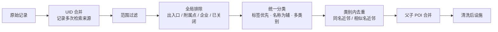

# 多源 POI 数据清洗策略

> 实现：`server/core/poi.js`（采集与清洗）、`server/core/categories.js`（分类体系与规则）

## 1. 数据源

| 数据源 | 获取方式 | 作用 |
|---|---|---|
| 百度地点检索 | 9 类设施 + 居住小区共 25 个关键词，圆形区域检索，分页直到取完（档位决定最大页数），`scope=2` 取得分类标签 | 主数据源 |
| 百度逆地理编码周边 POI | 中心点及外环 6 个点，`extensions_poi=1`，半径 1 km | 补充关键词检索遗漏的设施（如仅能由周边 POI 召回的社区公园） |
| OpenStreetMap（可选） | Overpass API，按设施标签检索，WGS-84 坐标经**百度坐标转换 API** 转为 BD-09 | 补充源；国内覆盖度有限，超时则自动降级 |

三路数据源**并发采集**。检索半径 = 最大可达距离 × 1.1 + 盲区阈值（约 2.2 km），以保证生活圈边缘点位在 1 km 盲区判定时也能找到候选设施。

## 2. 分类体系

| 维度 | 类别 | 关键设施 | 目标步行时间 | 圈内建议数量 | 主要匹配标签 |
|---|---|:-:|---:|---:|---|
| 生鲜购物 | 菜市场/生鲜 | ✅ | 10 分钟 | 2 | 菜市场、农贸市场、生鲜超市、果蔬超市 |
| 医疗健康 | 药店 | ✅ | 10 分钟 | 2 | 医疗;药店 |
| 基础教育 | 小学 | ✅ | 10 分钟 | 1 | 教育培训;小学 |
| 基础教育 | 幼儿园 |  | 5 分钟 | 1 | 教育培训;幼儿园 |
| 医疗健康 | 社区医疗 |  | 15 分钟 | 1 | 社区卫生服务中心、综合医院、中医院、诊所 |
| 养老服务 | 养老服务 |  | 15 分钟 | 1 | 养老服务、养老院、日间照料 |
| 生鲜购物 | 超市便利店 |  | 5 分钟 | 3 | 购物;超市、购物;便利店 |
| 公共交通 | 公共交通 |  | 5 分钟 | 3 | 公交车站、地铁站 |
| 休闲健身 | 公园体育 |  | 10 分钟 | 1 | 公园、休闲广场、体育场馆 |
| — | 居住小区（需求点） | — | — | — | 房地产;住宅区 |

目标时间与数量参考《城市居住区规划设计标准》GB 50180-2018、《社区生活圈规划技术指南》TD/T 1062-2021，统一在 `categories.js` 中配置。

## 3. 清洗流水线

### 3.1 统一分类：标签优先、名称为辅

一个 POI 会与**所有**类别逐一比对，而不只与检索它的关键词比对：

1. **名称排除规则**命中：拒绝（例如小学类别中的「培训 / 辅导 / 托管」）；
2. **标签排除规则**命中：拒绝（例如公园类别中的「健身房 / 私教 / 台球」）；
3. **标签匹配**（`tag` + `classified_poi_tag`）命中：接受（强证据）；
4. 仅当 POI 由该类别关键词检索得到、且标签为泛化标签（如「…;其他」）时，才用**名称规则**判定（弱证据）。

这样一来：

- 「谊品生鲜」（`购物;超市;生鲜超市`）会**同时**计入「菜市场/生鲜」和「超市便利店」，这对缺少传统菜市场的新城区非常关键；
- 检索「地铁站」返回的「MT 美发沙龙（西二旗地铁店）」「P+R 停车场」「B2 南口」会被正确剔除；
- 检索「健身广场」返回的大量商业健身房会被剔除，只保留公共健身广场与体育场馆。
- **兼容地区命名差异**：`购物;农贸市场`、`购物;菜店` 等明确的细分标签直接判为菜市场（如广州「冼村市场新街市」、生鲜连锁「钱大妈」）；只有宽泛的 `购物;市场` 才需要名称佐证，并接受「XX 市场」「XX 街市」的写法（如深圳「大冲五谊市场」），同时用排除规则过滤建材、服装、电子等非生鲜市场。这些规则在广州、深圳、成都、上海的实时体检中逐一核对过，并写成了回归测试。

### 3.2 软规则：避免误删正规机构

「集团 / 有限公司」「艺术 / 英语」这类名称规则被标记为**软规则**：当 POI 带有明确匹配的分类标签时，软规则不生效。例如：

- 「北京明天幼稚**集团**八幼佳园园」（`教育培训;幼儿园`）→ 保留
- 「中国音乐学院附属**艺术**幼儿园」（`教育培训;幼儿园`）→ 保留
- 「普康卫宁医疗器械**有限公司**」（无匹配标签）→ 剔除

### 3.3 去重

| 步骤 | 规则 |
|---|---|
| UID 合并 | 同一 UID 被多个关键词 / 数据源召回时合并，保留全部来源 |
| 同名近邻 | 同类别内规范化名称相同且距离 < 120 m |
| 相似名近邻 | 字符二元组 Dice 相似度 ≥ 0.8 且距离 < 60 m（跨数据源的同一设施） |
| 父子合并 | 「领秀新硅谷-D区」「XX 医院-门诊」「XX 公园-东区」并入父 POI（800 m 内），记录子项数量 |

名称规范化会去掉括号内的分店信息、空白与分隔符以及行政区前缀。分店信息只在「同名近邻」判断中被忽略，距离条件仍然保证不同分店不会被错误合并。

## 4. 清洗效果（标准档实测）

| 社区 | 原始记录 | UID 合并后 | 剔除噪声 | 近邻 / 父子去重 | 最终设施 | 居住小区 |
|---|---:|---:|---:|---:|---:|---:|
| 上地东里 | 798 | 674 | 152 | 156 / 13 | 302 | 56 |
| 望京西园 | 688 | 553 | 181 | 10 / 20 | 307 | 50 |
| 翠苑一区 | 899 | 714 | 189 | 5 / 13 | 462 | 68 |
| 回龙观西大街 | 653 | 501 | 169 | 2 / 13 | 275 | 56 |

上地东里的剔除原因分布：出入口/附属点 22、分类标签不符 18、企业/非零售实体 4、非基础医疗 3、非综合零售 3、商业健身会所 2、楼栋/非住宅 1、超出范围 2，另有 97 条逆地理编码返回的与民生设施无关的 POI（银行、酒店、写字楼等）。

每一类剔除原因都带有示例名称，在界面「设施」页可查看，便于人工复核与规则迭代。

## 5. 已知局限

- 百度地点检索按距离排序分页返回，单个关键词有页数上限（标准档 3 页 × 20 条），高密度片区会被截断，缺失的恰是远端、位于等时圈边缘的设施（磁盘缓存中 24 个社区里有 7 个社区的药店检索被截断）。处理方式：采集时记录被截断的类别，盲区判定后对盲区片区定点复核检索，补回的设施经同一套分类清洗与去重后并入清单并标注 `recheck`；也可以切换高精度档增加分页。
- 部分设施（如社区养老驿站）在地图数据中覆盖不足，报告中的「缺项」可能是数据缺失，不一定是设施真的缺失。可以借助界面的问答与规划建议提示人工核实。
- OSM 在国内的设施覆盖度差异很大（上地片区召回 226 条，其他样例几乎为 0），仅作为补充源。
