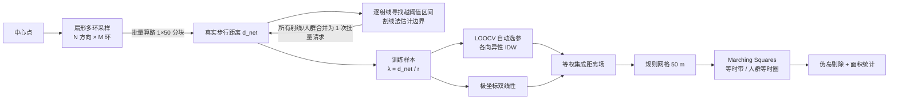

# 等时圈生成算法设计

> 目标：**不获取底层路网数据**，仅凭百度地图「批量步行算路」对分散点位的实测结果，推导出基于真实路网的 15 分钟步行可达区域，并给出连续的步行时间场（热力）。
>
> 实现：`server/core/isochrone.js`、`server/core/interpolation.js`、`server/core/contour.js`

## 1. 总体流程



## 2. 扇形多环采样

以中心点为原点，在 `N` 个等分方位角、`M` 个半径环上布点（直线距离，单位为最大可达距离 `D = v_max × T`）：

| 档位 | 方向 N | 半径环（× D） | 边界加密轮数 | 网格 | 典型请求数 |
|---|---:|---|---:|---:|---:|
| 轻量 | 16 | 0.35 / 0.65 / 0.95 / 1.3 | 1 | 70 m | 3 |
| 标准 | 24 | 0.3 / 0.55 / 0.8 / 1.05 / 1.35 | 2 | 50 m | 6 |
| 高精度 | 36 | 0.22 … 1.45（7 环） | 3 | 40 m | 10 |

- **为什么用批量算路**：「中心 → 多点」恰好是 `1 × K` 矩阵，单次请求最多 50 个元素，标准档 120 个环点只需 3 次请求；而逐点调用路线规划需要 120 次。
- **为什么半径环到 1.35 D**：绕行系数 λ ≥ 1，15 分钟边界一定落在直线距离 D 以内；取到 1.35 D 可以覆盖热力图 20 分钟色带，并为插值提供圈外约束。
- **一次采样、多人群复用**：API 返回的是**路网距离**，不同人群（成年人 1.2 m/s、老年人 0.9 m/s、亲子 1.0 m/s）只是阈值不同，三类等时圈共用同一批采样，**不额外消耗调用**。

## 3. 自适应边界加密

对每条射线，把采样点按半径排序（含原点 `(0, 0)`），找到首次越过阈值 `D_p` 的相邻采样对 `(r_a, d_a)`、`(r_b, d_b)`，以割线法估计边界：

```
r* = r_a + (D_p − d_a) / (d_b − d_a) × (r_b − r_a)
```

- 所有射线 × 所有人群阈值的新点**合并成一次批量请求**（标准档每轮约 24–59 个点 → 1–2 次请求）；
- 与已有采样点距离 < 25 m 的候选点跳过，避免重复；
- 射线上全部采样都未越过阈值时向外扩展 30%；
- 迭代 `refineRounds` 轮，边界附近的采样密度逐轮提高，而远离边界的区域不浪费调用。

这是一种「**只在需要的地方加密**」的主动采样策略：在上地样例中，标准档 198 个采样点里有 78 个集中在三类人群的边界附近。

## 4. 空间插值：从离散点到连续距离场

### 4.1 插值量的选择

| 插值量 | 重建公式 | 适用场景 |
|---|---|---|
| 绕行系数 λ = d_net / r | d̂ = λ̂ · r | 路网均匀、绕行随距离成比例 |
| 绕行增量 e = d_net − r | d̂ = r + ê | 河流、铁路、封闭大院等「一次性」屏障：越过屏障后增量沿射线基本不变，而 λ 会随距离衰减 |

直接插值时间或距离会在采样点之间「塌陷」（距离随半径单调增长，IDW 会把远近点平均），因此插值无量纲的 λ 或平稳的 e。

### 4.2 各向异性 IDW

距离度量采用极坐标各向异性形式：

```
d² = (r₁ − r₂)² + α · (r̄ · Δθ)²
```

`α` 控制角向与径向邻近的相对权重。同一射线上的点往往共享同一条道路走廊，`α` 可大于 1；而在方格路网中径向与角向同样相关，`α` 接近 1。

超参数 `(插值量, 幂次 p ∈ {1,2,3}, α ∈ {0.5,1,2,4}, 近邻数 k ∈ {6,10})` 共 48 组，**以留一交叉验证（LOOCV）平均绝对误差最小为准则自动选择**，不同社区会选出不同模型。例如上地选中 λ-IDW（p=3, α=0.5），翠苑和回龙观选中绕行增量模型，这与两地存在河道、大街区屏障的实际情况一致。

### 4.3 极坐标双线性

对方位角 θ、半径 r 的点，找到两侧相邻射线，分别沿射线按半径做一维分段线性插值，再按方位角线性加权融合。它保留了径向的高分辨率（边界加密点都在径向上），并在角向平滑过渡。

### 4.4 模型集成

两类模型的误差来源不同：IDW 捕捉面状空间相关，极坐标插值保留径向细节。最终距离场取二者**等权平均**，LOOCV 同时报告集成模型与单一模型的误差（见界面「技术指标」页）。

在 4 个样例社区、每个社区 120 个独立随机检验点的离线对比中（MAE，米）：

| 社区 | IDW（LOOCV 选参） | 极坐标双线性 | 集成 |
|---|---:|---:|---:|
| 上地东里 | 126 | 124 | 124 |
| 望京西园 | 58 | 61 | 59 |
| 翠苑一区 | 82 | 77 | 78 |
| 回龙观西大街 | 79 | 76 | 77 |

单一模型在不同社区各有胜负，而集成模型始终与较优者相差不超过 1–2 m，**消除了「选错模型」的风险**，因此作为默认方案。

## 5. 等值面提取

1. 在以中心为原点、边长 `2 × 1.3 D` 的规则网格（标准档 50 m）上计算每个节点的估计步行距离；
2. 用 marching squares（d3-contour）提取「距离 ≤ 阈值」的区域：
   - **人群等时圈**：阈值 = 各人群步速 × 15 分钟；
   - **分钟等时带**：2.5 / 5 / … / 20 分钟，前端由外向内叠加同色相半透明面，形成单色相顺序热力；
3. 网格外圈填充极大值，保证等值面在网格内闭合；
4. **伪岛剔除**：只保留包含中心点、或包含至少一个实测可达采样点的多边形分量，去掉插值产生的孤立碎片；
5. 在局部平面坐标下计算面积（扣除内环），并与「直线画圆」面积对比。

前端「测时探针」对同一网格做双线性插值，点击地图任意位置即可得到预计步行距离与各人群时间。

## 6. 容错与降级

| 情况 | 处理 |
|---|---|
| 个别采样点算路失败 | 该点不参与训练，由相邻点插值覆盖 |
| 有效采样点 < 8 | 退化为「区域 λ 中位数 × 直线距离」；完全无样本时使用经验值 λ = 1.35，并记录降级事件 |
| 某条射线全部失败 | 极坐标插值自动跳过该射线，由相邻射线过渡 |

## 7. 精度验证（摘要）

详见 [真实对比测试报告](./真实对比测试报告.md)。检验点与采样点相互独立，真值为百度批量算路实测距离：

| 社区 | 本系统 MAE | 直线画圆 MAE | 本系统圈内/圈外判定准确率 | 直线画圆判定准确率 |
|---|---:|---:|---:|---:|
| 北京 上地东里 | 126 m | 534 m | 97.5% | 60.0% |
| 北京 望京西园 | 59 m | 366 m | 97.5% | 72.5% |
| 杭州 翠苑一区 | 78 m | 421 m | 91.7% | 63.3% |
| 北京 回龙观西大街 | 79 m | 437 m | 91.7% | 70.8% |

直线画圆会把 15 分钟生活圈面积高估 **48%–66%**，并把大量实际步行 15 分钟到不了的点判为「圈内」。

## 8. 局限与改进方向

- 百度步行算路不含红绿灯等待时间，时间按「路网距离 ÷ 步速」换算；可结合实地抽检标定过街等待系数。
- 采样点可能被吸附到最近道路，封闭园区内部的可达性会被高估；可引入 POI 的出入口（`navi_location`）作为采样修正。
- 极端不规则的可达区域（例如被河流分隔的飞地）需要更多方向的采样，可切换到高精度档。
